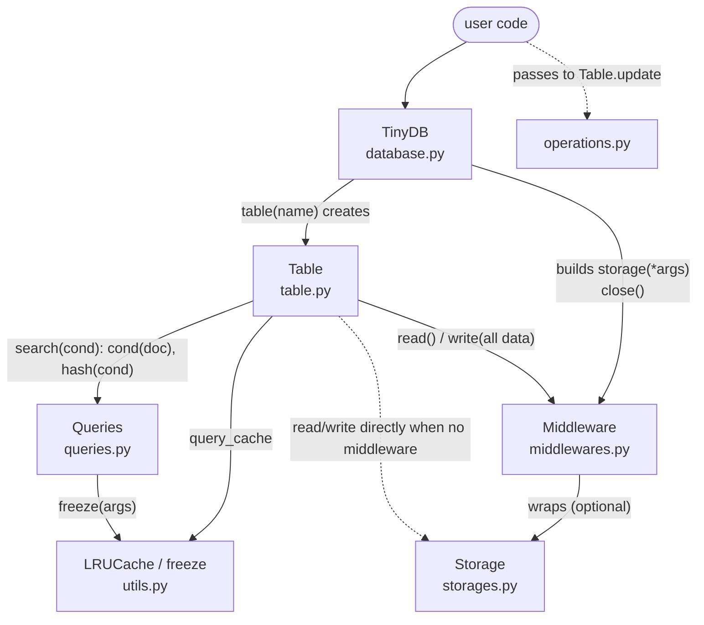

# TinyDB Architecture

TinyDB is a small document database written in pure Python. It has no runtime
dependencies (`pyproject.toml` declares none), so everything is built on the
standard library. A *database* holds named *tables*, a table holds *documents*
(dicts with an integer id), and the whole database state is persisted through
a pluggable *storage*.

## 1. Overview

### Components

| # | Component | File | Job |
|---|-----------|------|-----|
| 1 | `TinyDB` | `tinydb/database.py` | Entry point. Creates the storage from the `storage=` argument, hands out `Table` objects (`table_class`), closes the storage, and forwards unknown attributes (`insert`, `search`, ...) to the default table. |
| 2 | `Table` | `tinydb/table.py` | All document CRUD (`insert`, `search`, `update`, `remove`, ...), document ids, and the per-table query result cache. Every change goes through `_update_table`. |
| 3 | Queries (`Query`, `QueryInstance`, `QueryLike`) | `tinydb/queries.py` | Builds query objects (`where('a') == 1`, `&`, `\|`, `~`). A query is a callable `doc -> bool` with a stable hash used as the cache key. |
| 4 | Storage layer (`Storage`, `JSONStorage`, `MemoryStorage`) | `tinydb/storages.py` | Persists the *entire* database dict: `read()` returns it (or `None` if empty), `write(data)` stores it. |
| 5 | Middlewares (`Middleware`, `CachingMiddleware`) | `tinydb/middlewares.py` | Wrap a storage class to add behaviour (e.g. write caching) while looking like a storage. |
| 6 | Utilities (`LRUCache`, `freeze`, `FrozenDict`, `with_typehint`) | `tinydb/utils.py` | LRU cache for query results; `freeze` turns lists/dicts/sets into hashable forms for query hashes. |
| 7 | Operations | `tinydb/operations.py` | Ready-made update functions (`set`, `delete`, `increment`, ...) that callers pass to `Table.update`. Imports nothing from the package. |

### Who calls whom

Typical flow for `db.search(q)`: `TinyDB.__getattr__` forwards to the default
`Table` → `Table.search` checks its query cache using `hash(q)` → on a miss it
calls `storage.read()`, filters documents with `q(doc)` and caches the result.
A write such as `db.insert(doc)` goes `Table.insert` → `_update_table` →
`storage.read()`, mutate, `storage.write(all_tables)`, then the table's query
cache is cleared.

## 2. Architecture Decision Records

### ADR-1: Storages only read and write the *whole* database
- **Status:** Verified — explained in the docstring of `Table._update_table`
  (`tinydb/table.py:804-815`): "The storage interface used by TinyDB only
  allows to read/write the complete database data, but not modifying only
  portions of it."
- **Context:** TinyDB wants storages to be trivial to write (a few lines for a
  new backend) and independent of the table/document model.
- **Decision:** The `Storage` interface is `read() -> dict | None` and
  `write(data: dict)`, plus an optional `close()`. `Table` does
  read → modify in memory → write back for every change. Document ids are
  converted to strings on write because storages such as JSON need string keys.
- **Alternatives considered:** per-document or per-table storage methods
  (`insert_document`, `get`, `query`) that let a backend update incrementally.
- **Consequences:** + a new backend needs only two methods and is usable by
  every table and middleware. − every write serialises the whole database, which
  is why write caching exists (ADR-2). Storages must return `None` for "empty
  database" so `TinyDB` can initialise it.

### ADR-2: Middlewares wrap a storage *class* and imitate a storage
- **Status:** Verified — design is described in the docstring of
  `Middleware.__call__` (`tinydb/middlewares.py:25-61`).
- **Context:** Cross-cutting behaviour (caching, logging) should work with any
  storage without changing the storage or `TinyDB`.
- **Decision:** `Middleware(StorageClass)` is passed as `storage=`. `TinyDB`
  "calls" it like a class; `Middleware.__call__` instantiates the real storage
  with the same arguments, keeps it in `self.storage`, and returns itself.
  Unknown attributes are forwarded to the wrapped storage (`__getattr__`), so
  the middleware is a drop-in `Storage`. Middlewares can be nested.
- **Alternatives considered:** subclassing every storage per feature; hooks
  inside `TinyDB`/`Table`.
- **Consequences:** + features compose with any storage and `TinyDB` has no
  middleware-specific code. − the middleware must implement `read`/`write`/
  `close` itself (`CachingMiddleware` also tracks a closed state and flushes in
  `close()`), and must call `super().__init__(storage_cls)`.

### ADR-3: Queries are hashable values used as cache keys
- **Status:** Verified — commit `e433b9c` "Make queries hashable" (queries must
  be hashable so lists/dicts are "frozen" for the hash value) and `cc2d445`
  (docs note on possibly stale cached results); `Table.search` in
  `tinydb/table.py:249-298`.
- **Context:** Repeating a search should be cheap, but a query is built from
  Python lambdas which cannot be compared.
- **Decision:** Each `QueryInstance` carries a hash tuple (`_hash`) that
  describes the operation (operator tag, path, frozen arguments). Two queries
  with the same tuple are equal and share a cache entry. `Table` keeps an
  `LRUCache` of results keyed by the query and clears it after any write.
  Queries that cannot be described (e.g. `Query.map`, unhashable arguments)
  set `_hash = None` and report `is_cacheable() == False`.
- **Alternatives considered:** no cache; caching on the query's `repr`; cache
  invalidation per affected document instead of clearing all.
- **Consequences:** + repeated searches are served from memory. − the hash
  tuple is correctness-critical: if it does not distinguish two different
  queries, the cache returns wrong results; combining operators (`&`, `|`,
  `~`) must derive the hash from their operands. Cached documents are shared
  with the caller.

## 3. Constraints (rules not to break)

1. **New storages must subclass `Storage` and implement `read()` and
   `write()`** (both `@abstractmethod`; `close()` is optional). The storage
   must be constructible through `TinyDB(*args, storage=Cls)` — `TinyDB`
   just calls `storage(*args, **kwargs)`.
   *Seen in:* `tinydb/storages.py:36-76`, `tinydb/database.py:92-95`.
2. **`Storage.read()` returns `None` when the storage is empty**, and
   `write()` receives the full `{table_name: {doc_id: doc}}` dict.
   *Seen in:* `tinydb/storages.py:48-55`, `tinydb/table.py:789-792`,
   `tinydb/database.py:161`.
3. **Middlewares must wrap a storage class, call
   `super().__init__(storage_cls)`, and provide `read`/`write`/`close`
   themselves**; unknown attributes fall through to the wrapped storage.
   *Seen in:* `tinydb/middlewares.py:17-23`, `67-73`, `76-142`.
4. **Layering: dependencies point one way.** `queries.py` imports only
   `utils`; `storages.py` imports nothing from the package; `table.py` knows
   queries only through the `QueryLike` protocol and storages only through
   `Storage`; `database.py` is the only module that creates tables and
   storages. `queries.py` must not import `table.py` or `database.py`.
   *Seen in:* import lines of `tinydb/queries.py:23`, `tinydb/table.py:15-17`,
   `tinydb/storages.py:6-11`, `tinydb/database.py:7-10`.
5. **A query's hash must identify exactly what it matches.** Every query must
   carry a hash tuple built from its operator tag, path and (frozen)
   arguments, built with `freeze` for lists/dicts, or `None` if it cannot be
   cached. Combined queries derive their hash from their operands. Every
   table modification must go through `Table._update_table`, which clears the
   query cache.
   *Seen in:* `tinydb/queries.py:76-85`, `116-138`, `218-252`,
   `tinydb/table.py:853-854`, `tinydb/utils.py:150-168`.
