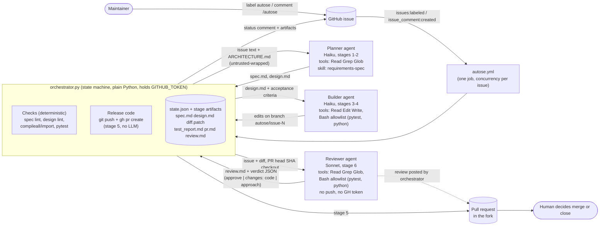

# Component view

**Who calls whom.** Only the orchestrator calls agents and GitHub. Agents never call each other; they communicate through files the orchestrator hands over (see ADR-003). The only component that holds the GitHub token is the orchestrator; agent subprocesses run with a stripped environment that contains the API key but no GitHub token (ADR-005).

**Back-edges (decided by the orchestrator, not by agents).**
- Stage 4 fail → stage 3 (budget 2 retries) → stage 2 once → stop with explanation.
- Stage 6 "changes: code" → stage 3; "changes: approach" → stage 2; at most 2 review rounds in total.
