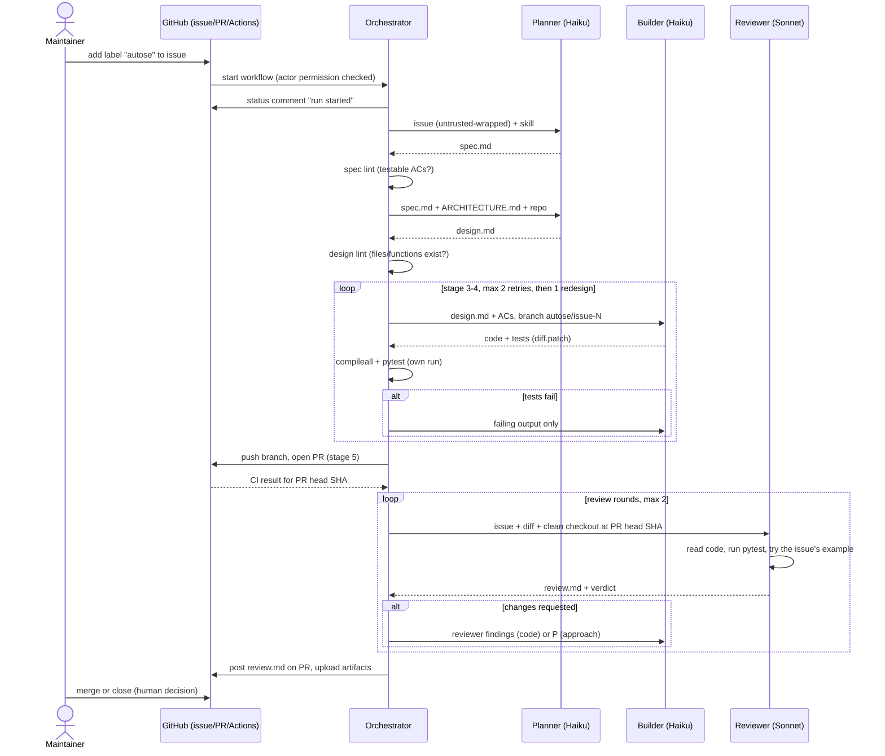

# Sequence view

> **Planned flow (written before any agent code).** After the first complete run this diagram is replaced by one drawn from the real run, with links to the Actions run, PR and review in `results/runs.md`.

